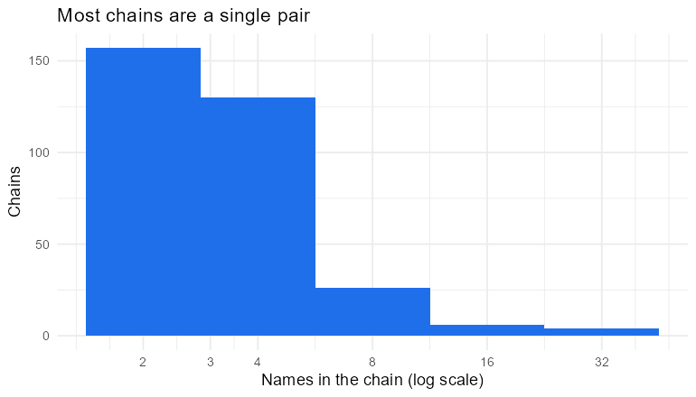

```{r, include = FALSE}
knitr::opts_chunk$set(collapse = TRUE, comment = "#>", echo = FALSE)
```

People appear under different forms of their first name across filings: ROBERT
one year, BOB the next, then ROBERT again. To link these records, the matcher
needs to know which first names are two forms of the same name.
`nickname_table()` held 70 formal names, which covered fewer than half of the
variants found in the data. This article describes the **first-name variant
table** that is meant to replace it: how it was built from the data, how it
was checked, and the chains its pairs form.

It is called a *variant* table, not a nickname table, because most of its
pairs are not nicknames. They also include spellings, compound names and
forms in other languages.

**Status.** The table and the scripts that build it are in
`dev/name-variants/` in the source repository. Its 1,007 lexicon pairs ship
with the package as `first_name_lexicon()`, and `compare_first_names()` uses
them alongside `nickname_table()`. To score with `nickname_table()` alone, as
before the lexicon, set `options(synthid.first_name_lexicon = FALSE)`.

## Where the pairs come from

Within-organization linkage (`link_panel()`) gives each person one `EMP_ID`
across years. One organization's filings are the most reliable place to see
a person's name change, because the organization, surname and role stay the
same. For every `EMP_ID` in the national Part VII build (15.0 million people,
2010-2024), the first-name forms seen across their records are collected.
Every two forms make a pair, written with the shorter form first. A person
listed as ROBERT, BOB and ROB gives three pairs. Each pair is counted by the
number of people who carry it.

| | |
|---|---|
| People with a first name | 14,915,238 |
| People with 2+ first-name forms | 448,794 (3.0%) |
| Distinct pairs | 55,310 |
| Pairs seen in 25+ people | 1,301 (2.4% of pairs, 78% of people) |
| Pairs seen in one person | 41,465 |

Most pairs are rare: 2.4% of the pairs account for 78% of the people. The
table is built from the pairs seen in 25 or more people, which were reviewed
by hand. The rarer pairs are kept as candidates (below).

## Variant types

| Type | Meaning | Examples | Where it goes |
|---|---|---|---|
| nickname | a different word for the name, incl. short forms and diminutives | BOB/ROBERT, CLINT/CLINTON, KATIE/KATE | table |
| spelling | the same name spelled another way | JEFFERY/JEFFREY, STEVEN/STEPHEN | table |
| compound | one part of a compound given name | MARY/MARYANN, ANN/ANNMARIE | table |
| cognate | the same name in another language | JOSE/JOSEPH, RICARDO/RICHARD | table, weighted less |
| typo | a misspelling of one name | JOSPEH/JOSEPH | errors file |
| parse error | not a first name | JP/JPMORGAN, WILLIAM/WILLIAMS | errors file |
| questionable | likely two different names or people | JOHN/JOSH, LISA/LINDA, PAUL/PAULA | questionable file |

For matching, short forms work like any other nickname: CLINT/CLINTON acts
like BOB/ROBERT. A rule that treats one name as a short form whenever it is
the start of the other is not safe, though. Such a rule also accepts
spellings (GREG/GREGG), compounds (MARY/MARYANN), names of the other gender
(PAUL/PAULA, JOE/JOEL) and typos (ROBER/ROBERT).

Typos stay out of the table. The scorer's string distance already matches
JOSPEH to JOSEPH, and a list of misspellings would only ever be partial.

## How each pair was classified

1. **Public tables.** Each pair is checked against `nickname_table()` and two
   public lists: [carltonnorthern/nicknames](https://github.com/carltonnorthern/nicknames)
   (1,232 formal names, Apache-2.0) and
   [onyxrev/common_nickname_csv](https://github.com/onyxrev/common_nickname_csv)
   (579 formal names). Two names count as listed if one is the other's formal
   name, or if both are nicknames of the same formal name.
2. **Rules.** A sound-alike spelling test (Soundex plus a length and edit
   distance limit), a diminutive test (KATIE/KATE, ANNIE/ANN), a
   compound-name test, and a frequency test for typos. A rare form that is
   under 2% as common as its partner, one or two letters away, and in no
   table is treated as a typo.
3. **Hand review.** All 1,277 frequent pairs of full names were read. The
   review set the questionable, cognate and parse-error lists, kept real
   variants that the typo test caught (DOUGLASS, JAYSON, CHARLEY), and fixed
   the type of pairs the rules got wrong. These decisions are written as
   lists in `02-classify.R`, so the classification can be rerun and audited.
4. **Evidence.** Two checks from the data, independent of the rules:
   - **Co-filing.** How often the two forms appear as separate people with
     the same surname on the same return. Two forms of one person's name
     rarely appear side by side on one return, but two different people
     (JOHN and JOSH SMITH) do. The median co-filing rate is 0.017 for
     nicknames, 0.006 for spellings and 0.088 for the questionable pairs.
     48% of questionable pairs are flagged, against 11% of nicknames.
   - **Gender.** Each form is recorded mostly with a different gender.

### What the evidence flags show

Of the pairs kept in the table, 82 carry a flag. They were checked again and
kept, with the flag recorded in the table:

- **Co-filing (66).** These are mostly diminutives that families use to tell
  relatives apart: JOHN/JOHNNY, JIM/JIMMY, DON/DONNIE (father and son, Sr and
  Jr). They are real variants, but weaker evidence that two records are the
  same person.
- **Gender (18).** These are unisex short forms such as PAT, JAMIE and RENE.
  The gender field is inferred from the first name, so it cannot settle these
  cases.

## The result

| File | Pairs | |
|---|---|---|
| `first-name-variants.csv` | 24,972 | the table. The 1,007 rows in the matching lexicon are 399 nickname, 556 spelling, 32 cognate and 20 compound pairs, covering 95% of the people behind the frequent pairs. The other 23,965 rows are sound-alike and misspelling pairs, kept outside the lexicon (below). |
| `first-name-variants-questionable.csv` | 83 | likely different names or genders |
| `first-name-variants-errors.csv` | 187 | 179 typos, 8 parse errors |

Of the 1,007 pairs, 447 appear in at least one public table. The other 560
were found only in the data. Most are spellings, but some are nicknames that
no public list includes: KATE/KATHLEEN, TERRY/TERRENCE, GERRY/GERARD.

## Checking for errors

`review-sample.csv` draws up to 40 pairs at random from each type in the
table, and from each group of candidates. Each pair is marked Y (same name),
N (different names) or ? (unsure). The first pass below was done by Claude
and still needs to be checked by a person.

| Group | n | Y | ? | N | Error rate (? = half) |
|---|---|---|---|---|---|
| table: nickname | 40 | 39 | 1 | 0 | 1.3% |
| table: spelling | 40 | 37 | 3 | 0 | 3.8% |
| table: cognate | 32 | 28 | 4 | 0 | 6.2% |
| table: compound | 20 | 20 | 0 | 0 | 0% |
| candidates: rule + support | 40 | 33 | 4 | 3 | 12.5% |
| candidates: in a public table | 40 | 33 | 7 | 0 | 8.8% |

Samples this small give wide 95% bounds, from 11% to 26%. The table's types
check out clean. Most of the doubtful pairs are cognates (MARIA/MARIE,
JOSE/JOSEPH), which is why cognates are kept as a separate type that can be
weighted less. The candidates have about twice the error rate of the table,
so they need review before they are added.

## Pairs seen in fewer than 25 people

52,467 pairs are kept as candidates, each with a gate that says how close it
is to being added:

| Gate | Pairs | Rule |
|---|---|---|
| ready: in a public table | 548 | listed in a public table |
| ready: rule + support | 779 | spelling, compound or cognate rule; 5+ people; both forms common |
| hold: red flag | 2,863 | co-filing or gender flag |
| hold: needs review | 26,968 | no rule or table support |
| excluded: rule | 21,309 | typo, parse error or questionable |

A sound-alike scan of the candidates found 23,965 pairs whose spellings sound
the same. Soundex alone would accept 30,554, but it also groups different
names such as DAN/DON and TIM/TOM. The stricter key normalizes spelling to
sound (PH=F, C=K or S, Y=I, silent H, doubled letters), keeps the first vowel
exactly, and drops later vowels.

These pairs are in the table under two types, outside the matching lexicon:

- **sound_alike** (13,748): both forms are established names (KRISTY/KRISTIE).
  These are the ones that could join the lexicon after review.
- **misspelling** (10,217): one form is rare, so it is a record error that
  happens to sound right (TODD/TOOD).

Matching treats the two the same, since both are spelling noise. The label
records the cause. Sounding alike does not make two forms one name, though:
JEREMY/JEREMIAH and ALEXA/ALEXIS both pass the key.

## The lexicon and fuzzy coverage

The `lexicon` column marks the rows a comparator should load: TRUE for the
reviewed nickname, spelling, compound and cognate pairs, FALSE for the
sound-alike and misspelling rows.

Many pairs do not need listing, because the fuzzy part of
`compare_first_names()` already scores them as a match. The table records
that score for every row:

- **`fuzzy_sim`**: what the comparator gives without its nickname lookup.
  That is Jaro-Winkler rescaled so unrelated names score near 0, raised to 0.5
  when Soundex agrees. The comparator is symmetric, so the score for A
  against B is the same as for B against A, and one column covers both
  directions.
- **`fuzzy_points`**: what that score adds to a match score,
  `5 * (2 * fuzzy_sim - 1)`.
- **`fuzzy_covered`**: TRUE when `fuzzy_sim` is at least 0.8, worth +3
  points or more. A listed pair scores 0.95 (+4.5), so listing a covered pair
  gains at most 1.5 points.

| Type | In lexicon | Pairs | Fuzzy covered | Penalized |
|---|---|---|---|---|
| nickname | yes | 399 | 8.5% | 83 |
| spelling | yes | 556 | 63% | 0 |
| cognate | yes | 32 | 41% | 0 |
| compound | yes | 20 | 0% | 0 |
| sound_alike | no | 13,748 | 72% | 10 |
| misspelling | no | 10,217 | 75% | 3 |

The lexicon holds what string distance cannot see: 609 of its 1,007 pairs
are not covered, almost all of them nicknames. Without the table, BOB/ROBERT
scores 0 and costs 5 points. Most rows outside the lexicon are already
covered, which is why they can stay out of it.

## Variant chains

Each lexicon pair links two names, so the lexicon forms a network. A **chain** is a
set of names connected through one or more pairs. The table's 1,007 pairs
connect 1,166 names into 323 chains. Most chains are a single pair or a
small family of forms. 15 chains have ten or more names.

```{r, out.width = "80%"}

```

Each lexicon row of the table records its chain: `chain_id` (1 is the largest),
`chain_names`, `chain_pairs`, and `chain_unlinked`. `chain_unlinked` counts
the pairs of names in the chain that are *not* themselves listed pairs. These
are the matches a rule would add if it followed links from pair to pair.

### Why matching must not follow chains

The largest chains show what goes wrong if links are followed. In chain 1,
AL is a nickname for ALAN, ALBERT, ALFRED, ALEXANDER and ALVIN, and BERT is a
nickname for both ALBERT and ROBERT. Following links would make ALAN match
ALFRED and ROBERT match FREDERICK. Of the name pairs in chain 1, 317 are not
listed pairs; only 34 are. In the same way, KATIE joins KATHLEEN to
CATHERINE, and MEG joins MARGARET to MEGAN.

So the table stores pairs, and a comparator tests each pair directly. It
does not map each name to one canonical form either, because KATE, AL, PAT
and RICKY each have more than one formal name. `compare_first_names()` already
works this way: it matches only a direct pair, a formal name and one of its
listed nicknames (ROBERT/BOB). Two nicknames of the same name (LISA and BETH,
both from ELIZABETH) do not match, because a person usually goes by one of
them, and treating them as the same name would merge two people. Cognates add
one more layer: RICKY/RICHARD and RICKY/RICARDO are both nicknames, while
RICARDO/RICHARD is a cognate. That is true for some people (an anglicized
name) and not for others, so it is weighted less.

(The classification above is looser on purpose. It counts a pair as listed
in a public table when the two names share a formal name, as a record of where
the pair came from. That is not how the comparator matches.)

### The five largest chains

Edge colour shows the pair type, and edge width shows how many people carry
the pair. Larger nodes have more links.

```{r, out.width = "100%"}
knitr::include_graphics(sprintf("figures/name-chains-%d.png", 1:5))
```

- **Chain 1 (27 names).** The AL/BERT family: ALAN, ALBERT, ALFRED,
  ALEXANDER, FREDERICK and ROBERT, joined through AL, BERT and FRED.
- **Chain 2 (24 names).** ELIZABETH and its many short forms (BETH, BETSY,
  BETTY, LIBBY, LIZ, LISA). It also picks up ELEANOR, ELLEN and EILEEN
  through ELLIE.
- **Chain 3 (24 names).** KATHERINE, CATHERINE, KATHLEEN and KATHRYN, joined
  through KATE, KATIE and KATHY.
- **Chain 4 (23 names).** CHRISTINA, CHRISTINE, KRISTIN, KRISTEN and KIRSTEN,
  joined through KRIS, CHRISSY and spelling variants.
- **Chain 5 (14 names).** MARGARET's short forms (MEG, PEGGY, MAGGIE, MARGE),
  joined to MEGAN through MEG and to MARJORIE through MARGE.

## Effect on matching

Two checks on one combined statistical area (CSA 450), each run with the
lexicon on and off.

**Seeded recall (06j).** Pairs of rare, identical names that score 11 or more
are near-certain matches. Rewriting one side's first name shows whether the
pair is still found:

| Rewrite of one side | Seeds | Score >= 7, before / after | Score >= 10, before / after |
|---|---|---|---|
| nickname that only the lexicon lists | 274 | 90.9% / 100% | 15.7% / 100% |
| spelling variant from the lexicon | 723 | 98.2% / 100% | 52.0% / 100% |
| a different name (JOHN -> JOSH), lower is better | 252 | 91.7% / 91.7% | 35.3% / 35.3% |

Every other rewrite gives the same result with the lexicon on or off. The last
row checks for false matches, and the lexicon does not change it. It also
shows a weakness that predates the lexicon: a different first name on
otherwise identical rare names still scores 7 or more nine times in ten.

**Cross-org matches (06n).** The CSA's 14.3 million candidate pairs were
rescored. Because the score is additive, the first-name change could be
applied exactly to the 11,587 pairs it affects. A full rescore of a sample
matched to within rounding.

| Threshold | Before | After | Gained | Lost |
|---|---|---|---|---|
| score >= 7 | 89,237 | 93,246 | 4,009 (+4.5%) | 0 |
| score >= 10 | 40,762 | 41,107 | 345 (+0.8%) | 0 |

Of the 4,009 new matches at 7, 2,454 rest on a nickname, 1,105 on a spelling,
417 on a cognate and 33 on a compound. The most common are JOHN/JONATHAN
(616), MARIE/MARY (268), KIM/KIMBERLY (186) and SUSAN/SUZANNE (153). Two of
those carried a warning in the review: JOHN/JONATHAN and MARIE/MARY also
appear as two people on one return, so their new matches deserve a look.

**Name checks (06k).** The post-match name checks were rerun on the rescored
matches. Among matches at 7 or more:

| First-name relation | Before | After |
|---|---|---|
| same | 76,026 | 76,026 |
| nickname | 10,068 | 12,597 |
| spelling | 2,310 | 3,391 |
| cognate | 0 | 465 |
| different (two established first names) | 534 | 471 |

The surname check still sorts its calibration sets the same way. It calls
2.0% of the trusted matches "different" (before: 1.8%) and the same 52% of the
negative pairs.

The new matches are weaker on average than the old ones, as expected for pairs
that were just below the threshold. 38% of the 4,009 gained matches have
different best surnames, against 15.5% of the existing matches. 299 of them
(7.5%) have two different established surnames, against 4.2% before. Middle
initial conflicts rose by 22. These gained matches, and the flagged pairs
behind many of them, are where to look first if the lexicon admits false
matches.

## Rebuilding the table

The scripts are in `dev/name-variants/` and run from the package root. The
data come from the national build in `SYNTHID_DIR`.

| Script | Does |
|---|---|
| `00-variant-pairs.R` | pairs of first-name forms within each EMP_ID |
| `01-pair-evidence.R` | co-filing counts and the gender recorded with each first name |
| `02-classify.R` | types, public-table checks, hand-review lists, output files, review sample |
| `03-review-first-pass.R` | the first-pass review calls and error rates |
| `04-sound-alikes.R` | sound-alike spellings among the candidates |
| `05-chains.R` | chains, the chain columns, and the figures in this article |
| `06-lexicon.R` | adds the sound-alike rows, the `lexicon` column and the fuzzy-coverage columns |

The public tables are copied in `dev/name-variants/reference/`.
